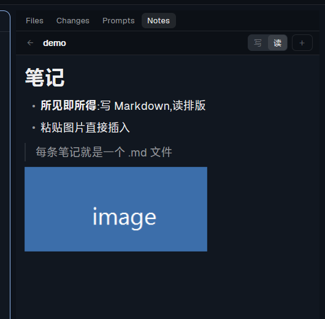

# herdr-app-mod-notes



Markdown notes beside your agents: write them in the panel, read the rendered version, and paste a
picture straight into the text.

## Install

Ask your agent in Herdr:

```text
Read ~/.config/herdr-app/AGENTS.md, then add the mod at https://github.com/AlanWanco/herdr-app-mod-notes
```

Or by hand: copy `mods/notes/` into `~/.config/herdr-app/mods/`, add
`"alt-n": "mod.open:notes"` to `global` in `~/.config/herdr-app/keys.json`, and run
`herdr-app check ~/.config/herdr-app/mods/notes`.

## What it does

- **Notes are files**: `~/.config/herdr-app/notes/<agent>/<name>.md`, one folder per agent (the one in
  front: `focused().agent`; `shared` when no agent has focus). Edit them in any editor; the list
  re-reads the folder every few seconds.
- **写 / 读**: the write side is a textarea, the read side renders the markdown — headings, bold,
  lists, inline code, links, quotes. Autosave 0.7 s after typing stops.
- **Pictures**: paste an image into the textarea (a paste with no text) and it is saved to
  `notes/images/img-<time>.png` and appended as ``; dropping an image file does
  the same through ffmpeg. The preview draws them at their own aspect ratio, fitted to the column.
- `＋` creates `note-<time>.md`; `←` goes back to the list. The same mod opens as a 620×660 dialog
  (`alt-n`) when you want room.

## Limits

This UI has no rich-text editor: `Textarea` is plain text and `TextView.markdown` is read-only, so
"what you see is what you get" is a one-key toggle between writing and the rendered result, not
in-place rendering.

## Requirements

- Windows: `powershell` for the clipboard image. `ffmpeg` for pictures dropped as files.
- macOS/Linux: the clipboard picture path is Windows-only for now.

MIT licensed.
